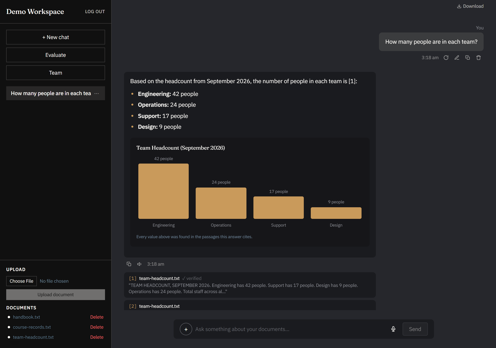
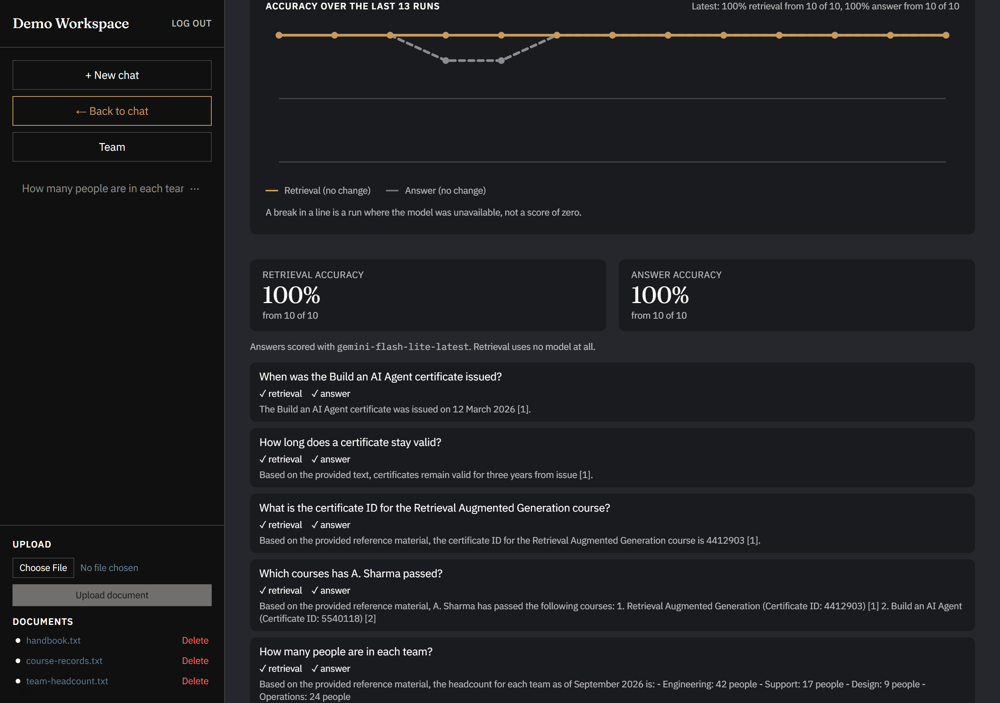
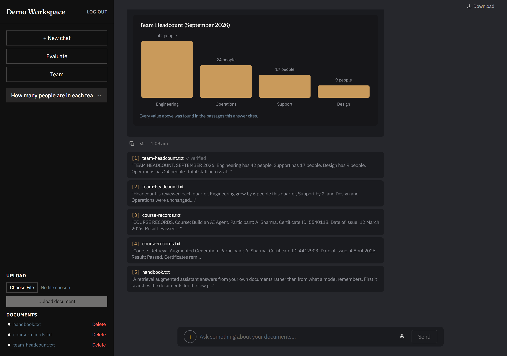
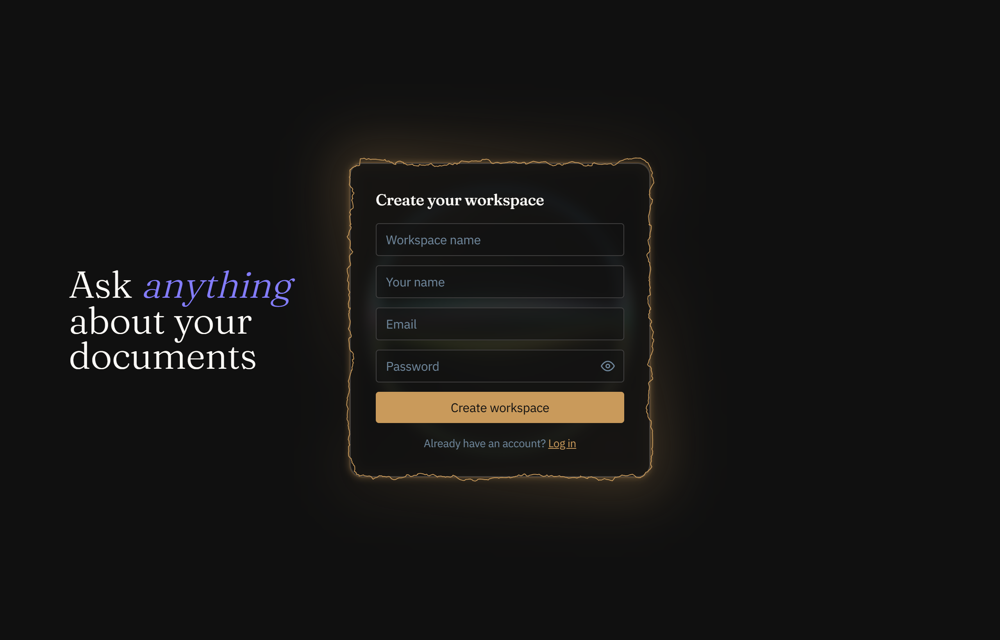
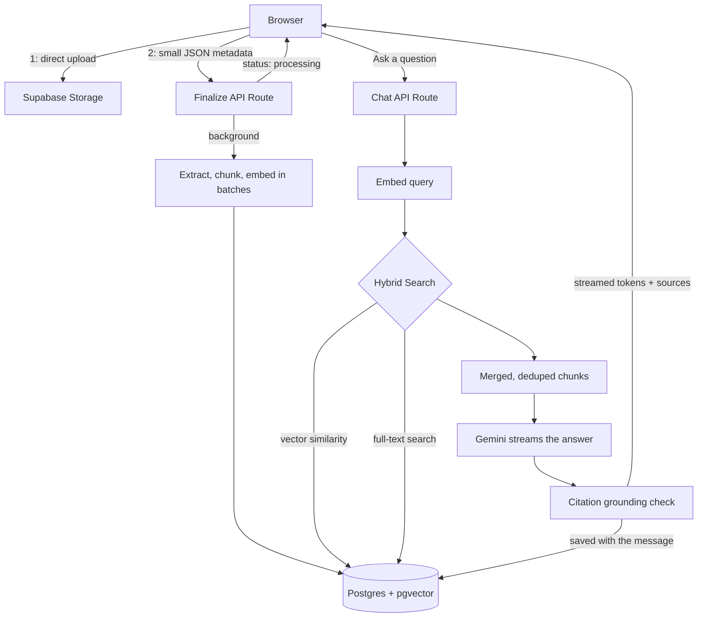

# RAG Assistant

**A multi-tenant document Q&A platform.** Upload your documents, ask questions, and get answers grounded in your own content with citations that are checked against the source. Built end to end: workspace isolation enforced in the database, hybrid retrieval, citation verification, team accounts, a built-in evaluation harness, and a custom UI with WebGL visuals.

🔗 **[Live demo](https://rag-assistant-gamma.vercel.app)** · 📦 [Source](https://github.com/mKs2609/rag-assistant)

[](https://github.com/mKs2609/rag-assistant/actions/workflows/ci.yml)


---



*An answer built from the uploaded documents: markdown rendering, a chart whose every value was checked against the passage it came from, and the sources behind it.*



*The project measures itself. Each saved question names the document it should find and the words the answer should contain, and the panel says which model produced the answers. Retrieval and answer coverage are counted separately, because searching needs no model at all, and every run is kept so the scores can be compared over time rather than judged one at a time. The ten questions shown are a small demo workspace used for these screenshots, not the 41-question set the figures elsewhere in this README come from.*

<details>
<summary><b>More screenshots</b></summary>

<br>



*Each source is shown with the passage it contributed. A citation is marked verified only when its wording matches the text it points at.*



*Signing up creates the account and its workspace in one step, which is where the multi-tenancy starts. The background is raw WebGL, drawn without an animation library.*

</details>

---

## Why this isn't just another "chat with your PDF" demo

Most RAG tutorials stop at: embed one PDF, run a vector search, paste the result into a prompt. That is a fine starting point, and it is also where most student projects end. This one goes further on the parts that matter once more than one person uses it:

- **Multi-tenant from the database up.** Every table and the storage bucket enforce workspace isolation with Postgres Row-Level Security, not application-level `if` statements that are easy to forget. The full schema, including every policy, is in [`/schema`](schema).
- **Hybrid retrieval, not just vector search.** Embedding search is weak at exact lookups such as a certificate code or an ID number. This runs pgvector cosine similarity and Postgres full-text search side by side and merges the results. Measured as an ablation over 39 scored questions: vector-only 90%, full-text-only 21%, both 100%. On bare identifier lookups specifically, vector search found 0 of 5 and full-text found 4 of 5.
- **Citations are checked, not trusted.** After the model answers, each citation is compared against the text it claims to be quoting, and answers show a verified or unverified badge per source.
- **It measures itself.** A built-in evaluation harness scores retrieval and answer accuracy against saved question and answer pairs, so changes can be checked instead of guessed at. The current set is 41 questions over a 272-chunk corpus. The last run answered 41 of 41 correctly and retrieved the right document for 39 of 39, which is every question that names one; the remaining two span several documents, so they are left unscored for retrieval rather than counted as passes. The counts are quoted alongside the percentages deliberately: a bare 100% says nothing without knowing how many questions it was over, and which of them could fail.
- **Rate limiting on every endpoint that costs money:** chat, upload, evaluation runs, and signup.
- **A real infrastructure limit, solved rather than worked around.** Vercel caps serverless request bodies at 4.5MB, which breaks file uploads. Uploads now go straight from the browser to storage, and only small metadata passes through the function. See [Engineering decisions](#engineering-decisions) below.

## Features

**Chat and retrieval**
- Hybrid vector and keyword search over chunked, embedded documents
- Conversation memory, so follow-up questions work without repeating context
- Per-conversation document scoping, with an inline picker to attach more documents mid-chat
- Streaming answers with live progress: searching, how many passages were found, then writing
- Citation grounding checks, saved with the answer so they survive a reload
- Answers render as real markdown: headings, tables, bulleted and numbered lists, code blocks
- Charts when an answer compares several numbers, with every value checked against the passage it came from
- Each answer shows how long it took, split by retrieval and model
- A row of controls under every message: a question can be copied, asked again, edited and asked again, or deleted; an answer can be copied as readable text or read aloud. Each shows the time it was sent
- Delete a question and its answer, with failed sends cleaned up automatically
- When the main model's daily free allowance is gone the chat answers with the lighter model instead of stopping, and says so under the answer
- If the search itself fails, the answer stops and says so, rather than letting the model answer from no reference material at all
- Voice input and read-aloud using the browser's built-in speech APIs
- Shared chats show who asked each question
- Conversation history with rename, pin, delete, and plain-text export

**Teams**
- Workspaces with owner, admin and member roles
- Single-use invite links that expire after 7 days
- Shared conversations, where only the author or an owner/admin can rename, pin or delete
- Member management, including removing members

**Evaluation**
- Save question and answer pairs with an expected document and expected keywords
- Score retrieval accuracy and answer accuracy, for the whole set or one question
- Retrieval is scored separately from the answer, so a day when the model is out of quota still gives a full retrieval measurement
- Each run starts one question further along, so the questions at the end are not the ones permanently left unscored when the time budget runs out
- Questions the model never reached read as "not scored" rather than as failures, and each coverage is reported with its own number
- Every full run is stored, so the panel charts accuracy across runs instead of only the latest
- The current set is 41 questions over a 272-chunk corpus: exact identifiers, paraphrase, arithmetic the documents do not state, cross-document comparisons, distractors, and questions the documents genuinely cannot answer

**Documents**
- PDF, TXT and MD up to 10MB, uploaded straight from the browser to storage
- Scanned PDFs fall back to OCR, so image-only documents are still searchable. Long scans are read 10 pages at a time
- Processing runs in the background, so uploads return immediately and the list updates itself
- Embeddings are sent in small batches, sized for the embedding tier's tokens-per-minute limit rather than its per-request limit, which is what actually binds
- A document that fails to process says why, in words meant for the uploader, instead of only showing "failed"

## Architecture



## How it works

| Step | Detail |
|---|---|
| Chunking | 1000 characters with 150 characters of overlap |
| Embeddings | Voyage AI `voyage-3.5`, 1024 dimensions. Batches are capped at 25,000 characters, roughly 25 chunks, because the free tier allows 10,000 tokens a minute and that binds long before the 128-input per-request cap |
| Retrieval | Top 5 by vector similarity plus top 5 by full-text search, merged and deduped to 6 |
| Conversation memory | The last 10 messages are replayed to the model |
| Citation check | A citation is verified when at least 30% of the sentence's significant words appear in the cited chunk |
| Chart check | Each data point must name a source, and both its number and its label must appear in that passage |
| Keyword index | A GIN index on `to_tsvector('english', content)`, without which every search scans every chunk |
| Rate limits | Chat 15 per 5 min, uploads 10 per 10 min, evaluations 5 per 10 min, signups 5 per hour per IP |
| Model quota | The chat model's free tier allows 5 requests a minute and 20 a day, and the chat falls back to the lite model when the day's allowance is gone. Evaluations run on the lite model instead, which allows 15 a minute on its own allowance, so scoring a set never competes with the chat for the day's requests. A run paces requests 4.5s apart, does not retry inside a run, and stops asking once an allowance is gone |
| Model thinking | The flash models reason before answering by default, measured at 19s a call against 3s without. Every answer here comes from passages already supplied, so requests ask for no thinking |

## Security

- Row-Level Security on every table and on the storage bucket, all expressed through one `auth_tenant_id()` helper
- Storage paths are prefixed with the workspace id, and the server checks the prefix before trusting a client-supplied path
- IDOR protection on document, conversation and message routes, with workspace filters in the API as a second layer
- Prompt-injection defense: retrieved content is passed as untrusted reference material, never as instructions
- Invite links are claimed atomically, so the same link cannot be used twice at the same moment
- Email verification at signup, with a resend option on the login page
- Accounts that are never confirmed are deleted after 7 days by a nightly database job, with the empty workspace they created
- Password reset by email that works even when the link is opened on another device, and signs out other sessions afterwards
- Signup gives the same response whether or not an email is already registered
- File size is enforced on the server, not just in the browser
- The rate-limit table has RLS enabled with no policy, so only the service role can touch it

## Engineering decisions

**The 4.5MB wall.** Uploads worked locally and then failed in production for anything over a few megabytes, with no error from my own code. Vercel enforces a 4.5MB request body limit on serverless functions at the infrastructure level, and no application config overrides it. The fix was to take the file out of the request entirely. The browser uploads directly to Supabase Storage under the same RLS policies that already govern workspace access, and only a storage path and filename go through the function.

**Why hybrid retrieval, and what it is worth.** Testing with real documents, such as certificates containing codes like `9977287`, showed that vector search sometimes missed the chunk holding an exact code, because embeddings capture meaning rather than exact tokens. Running Postgres full-text search alongside it closed the gap without adding infrastructure, since full-text search is already part of Postgres.

That was a judgement call made from watching it fail, so it was measured afterwards as an ablation: the same 272-chunk corpus and the same budget of 6 passages, changing only the search method. Of the 41 questions in the set, 39 name an expected document and so can be scored for retrieval; the other two span several documents and are deliberately left unscored rather than counted as free passes.

| Retrieval method | Expected document retrieved |
| --- | --- |
| Vector search only | 90% (35/39) |
| Full-text search only | 21% (8/39) |
| Both, merged, what ships | **100% (39/39)** |

The four questions hybrid retrieval rescues are all bare identifier lookups, the case it was added for. Tested on their own, with the code pasted and no sentence around it, **vector search found 0 of 5 and full-text search found 4 of 5**.

Worth saying plainly: the first run of this ablation reported hybrid retrieval as worthless, because vector-only also scored 100%. Every question in the set was a full sentence, and vector search handles those well, so the set could not see the one case the feature exists for. Adding identifier questions is what made the measurement honest. A result saying a feature does nothing is a claim about the test set as much as about the feature.

**The limit I was not watching.** A 163-chunk document would not upload. Small files were fine, the file reached storage, and the list said only `failed`. The error body had the answer: the embedding free tier allows **3 requests a minute and 10,000 tokens a minute**, and the second one binds. At roughly 227 tokens per 1000-character chunk, a minute buys about 44 chunks, while the pipeline was batching up to 128 chunks, around 29,000 tokens, in a single request. Such a request can never succeed, so waiting did not help and retrying only spent attempts. Any document over about 44 chunks failed permanently. Three fixes: batch for the limit that binds, wait out the window on a rate limit rather than backing off two seconds against a limit lasting sixty, and stop cleanly when the function's deadline is near instead of being killed mid-embed and leaving the document stuck on "processing".

**Saying why, not just that.** That took far longer to diagnose than it should have, because the pipeline knew exactly what had gone wrong and discarded it: the reason went to a server log and the document row only recorded `failed`. It is now stored and shown under the filename. The translation matters as much as the storage, since the raw rate-limit body names the provider, the quota tier and a billing page, and none of that belongs in a tenant's document list. A test asserts those words never reach the uploader.

**Citation verification for free.** The usual approach is a second LLM call, which costs money per check and adds latency. This compares the significant words of a cited sentence against the source chunk instead. It is less sophisticated than a model-based check, but it catches the failure that matters, a citation that does not match its source, at no extra cost.

**Processing off the request path.** Extracting and embedding a large PDF takes far longer than a request should. Processing now runs after the response is sent, using Next.js `after()` with an explicit time budget, and the document list polls until the status changes. Uploading a large file no longer blocks the browser or times out silently.

**OCR only when it's needed.** Scanned PDFs hold images rather than text, so extraction returned nothing and the upload failed. Rather than add an OCR engine to the serverless function, which is slow and heavy, the pipeline falls back to Gemini when a PDF yields almost no text and asks it to transcribe the pages. Normal PDFs never pay that cost, and it reuses the API key that was already there.

**Long scans, measured rather than guessed.** Splitting a scan into 10-page requests and sending them in parallel looked like the obvious speed-up. Measured on a 23-page scan, it was the opposite: 34 seconds one group at a time versus 252 seconds with three in parallel, because the free Gemini tier queues parallel requests from one key. So groups run one at a time, processing has a 300 second budget, and OCR checks the clock before each group. If time is about to run out it stops and marks the document failed, instead of the platform killing the function and leaving it stuck on "processing".

**The index that was never there.** Keyword search filtered on `to_tsvector('english', content)` with no index, so every question sequentially scanned every chunk and built the vector twice per row. Measured on 20,000 chunks, a search took 1716ms round trip, about 1400ms of it query time. A GIN index on that expression took it to 311ms round trip and about 10ms of query time, and needed no change to the search function. A first attempt used a stored generated column instead, which rewrites the table and therefore rebuilds the pgvector index, and that rebuild needs more memory than a small instance has. An expression index touches nothing else.

**Charts are verified like citations.** A fabricated chart is more convincing than a fabricated sentence, because people read a bar as data rather than as a claim. The model emits chart data as JSON naming the source of each point, and the server checks both the number and the label against that passage before anything is drawn. Points that fail are drawn as a dashed outline and flagged, not silently dropped. Verification runs on the server because the browser only receives a 150 character snippet of each source, far too little to check a number against.

**Scoring on a different model from the one being scored.** A full evaluation needs one model call per question, and the chat model's free tier allows twenty a day shared with the chat itself, against a set that was twenty-two questions at the time and is now forty-one. Twelve runs never once scored the whole set. The lite model allows fifteen requests a minute on a separate allowance, so evaluations run on it and a full set completes in under two minutes without touching the chat's budget. The panel names the scoring model beside the percentages, because a number produced by one model should not be read as a measurement of another.

**Handling a busy model.** Gemini returns 503 when it is under load, and a single attempt failed often enough to be a problem. Requests now retry with backoff before giving up, and the user sees a short message rather than a raw API error. A failed question is removed from the chat instead of being left unanswered.

## Tech stack

| Layer | Choice |
|---|---|
| Framework | Next.js 16 (App Router), TypeScript |
| Styling | Tailwind CSS v4 |
| Database | PostgreSQL via Supabase, with `pgvector` |
| Auth | Supabase Auth |
| File storage | Supabase Storage |
| Embeddings | Voyage AI (`voyage-3.5`) |
| LLM | Google Gemini (`flash` for answers, `flash-lite` for scoring evaluation runs) |
| Deployment | Vercel |
| Custom visuals | Raw WebGL via `ogl`, no animation library |
| Tests | Vitest unit tests, and Playwright end-to-end tests in a real browser |
| CI | GitHub Actions: lint, typecheck, unit tests and build on every push; end-to-end tests weekly and on demand |

## Getting started

```bash
git clone https://github.com/mKs2609/rag-assistant.git
cd rag-assistant
npm install
```

Create `.env.local`:

```
NEXT_PUBLIC_SUPABASE_URL=
NEXT_PUBLIC_SUPABASE_ANON_KEY=
SUPABASE_SERVICE_ROLE_KEY=
VOYAGE_API_KEY=
GEMINI_API_KEY=
```

Create a Supabase project, then run the files in [`/schema`](schema) in order (`001` to `016`) in the SQL Editor. They create the tables, indexes, search functions, RLS policies and the storage bucket, and can be re-run safely. Then:

```bash
npm run dev
```

Other scripts:

```bash
npm run lint       # eslint
npm run typecheck  # tsc --noEmit
npm test           # vitest
npm run build      # production build
npm run test:e2e   # playwright, see below
```

### End-to-end tests

Seven tests drive a real browser: the four auth paths, a document that failed to process showing its reason without leaking the upstream error, a document that processed normally showing none, and the full pipeline of uploading a document, asking about it, getting a cited answer and deleting the question. Only that last one needs the language model, so the rest run whatever is left of the day's allowance.

They create and delete users and data, so they need **their own Supabase project**, never the real one, and they refuse to start if pointed at the project in `.env.local`.

1. Create a second Supabase project and run the `/schema` files in it
2. Copy `.env.e2e.example` to `.env.e2e` and fill in that project's URL and keys
3. Run `npm run test:e2e`

In CI they run from the **E2E** workflow, weekly and on demand, using the same values stored as repository secrets. They call Voyage and Gemini for real, which is why they don't run on every push.

## Project structure

```
app/
  api/           # chat, documents, conversations, messages, eval, team, invites, profile, tenants
  dashboard/     # main authenticated UI: chat, documents, evaluation, team
  login/ signup/ # auth pages
  forgot-password/ reset-password/ # password reset by email
  invite/        # public invite acceptance page
components/      # custom WebGL visual components
lib/
  __tests__/     # unit tests for the pure functions
  documents/     # chunking, embedding and processing pipeline
  citations.ts   # citation grounding check
  charts.ts      # chart grounding, and writing verdicts back into an answer
  markdown.ts    # parses an answer into blocks, including charts
  eval.ts        # scoring a run, retrieval and answer counted separately, question rotation
  retrieval.ts   # merging the two searches, shared by the chat and the evaluation harness
  gemini.ts      # gemini calls: retries, timeouts, quota messages, no thinking
  trend.ts       # geometry for the evaluation accuracy chart
  clipboard.ts   # copy to the clipboard, with a fallback for browsers without the API
  stream.ts      # reassembling answer events split across network chunks
  conversation-export.ts # building the plain text export of a chat
  uuid.ts        # checking ids from a request before they reach Postgres
  time.ts        # short timestamps for the message buttons
  theme.ts       # the accent colour as a value, for props that need one
  ocr.ts         # OCR fallback for scanned PDFs
  hooks/         # speech recognition and synthesis
  supabase/      # browser, server and admin clients
schema/          # SQL migrations, run in order
e2e/             # playwright end-to-end tests
```

## Known gaps

- **Very long scans can still fail.** OCR reads 10 pages per request, one request at a time, within a 300 second budget. Gemini's response time varies a lot, so a scan of many dozens of pages may run out of time and be marked failed rather than finishing.
- **Large uploads are slow on the free embedding tier.** Batches are sized for 10,000 tokens a minute, so a 160-chunk document spends around three minutes embedding inside a five-minute function budget. It completes, but there is not much headroom; a paid embedding tier removes the constraint entirely.
- **Short numbers don't count toward citation checks.** Words of two characters or fewer are ignored, so a day of the month like `15` is never used to verify a citation. Expected keywords in the evaluation are matched at any length, so this affects grounding only.

## Roadmap

- Reranking the retrieved passages with a second model, measured through the evaluation harness
- Citation deep links, by storing a page number and offset on each chunk
- Multilingual retrieval, choosing the text search configuration per document language
- Model-based citation verification as an optional higher-fidelity mode
- Support for embedding providers beyond Voyage AI

## License

MIT, see [LICENSE](LICENSE).

---

Built by Mohit Kumar.
